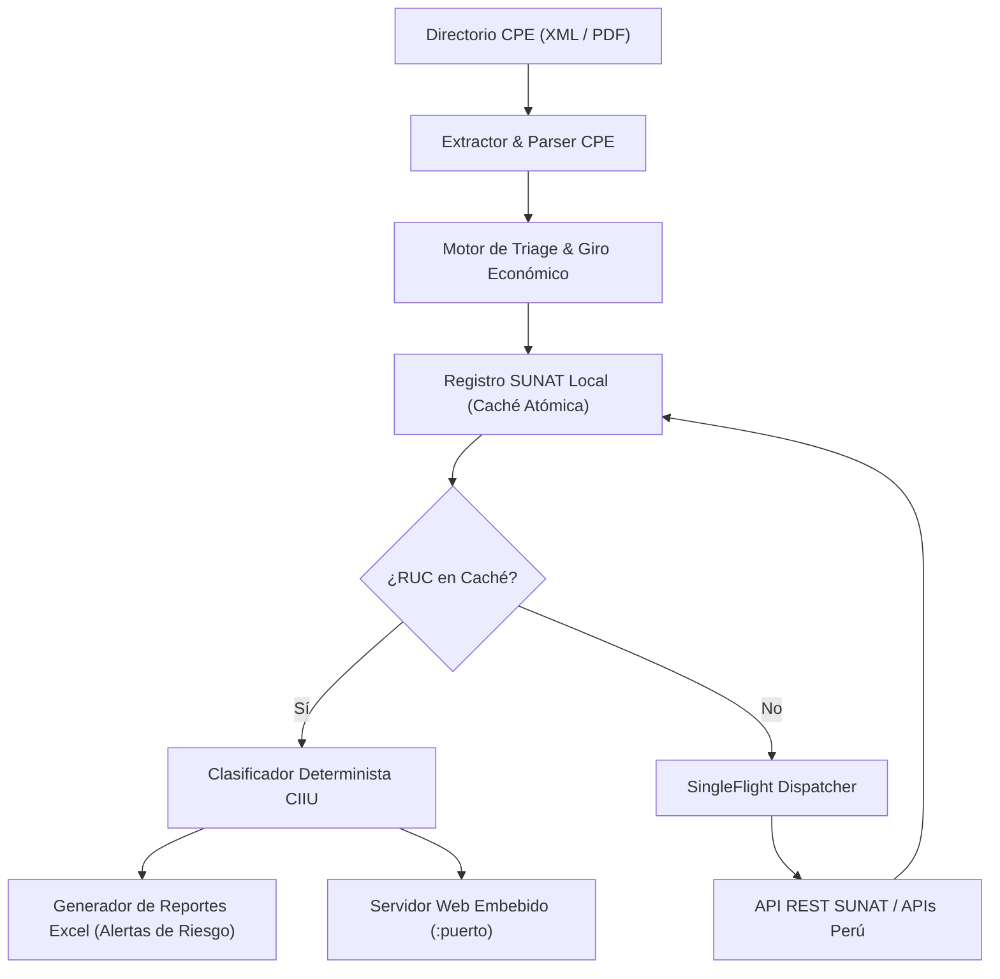

# Audit CPE Engine (v2.1.0) — Arquitectura de Misión Crítica

Motor de auditoría tributaria determinista, clasificación económica y triaje de Comprobantes de Pago Electrónicos (CPE / XML / PDF) para el sistema fiscal peruano (SUNAT).

---

## 📌 Especificación Técnica del Sistema

- **Runtime & Compilación:** Go nativo puro (`CGO_ENABLED=0`), compilación cruzada para Linux (`x86_64`) y Windows 10/11 (`audit_cpe_windows.exe`).
- **Huella de Memoria:** Binario autocontenido de ~12 MB con interfaz web embebida (`//go:embed embedded_ui/*`). Consumo en reposo < 35 MB RAM.
- **Concurrencia & Thread-Safety:**
  - `sync.RWMutex` para sincronización de resultados en memoria.
  - Patrón **SingleFlight** para evitar efecto avalancha (*thundering herd*) en consultas salientes hacia la API de SUNAT.
- **Almacenamiento & Caché Local:** Persistencia atómica de catálogo en `sunat_cache.json` con mapeo determinista de códigos CIIU Rev. 4 (Consultoría TI, Courier, Minería, Servicios Generales).
- **Reportes:** Motor de compilación Excel multicapa (`excelize`) con banderas de advertencia tributaria (`NO HABIDO`, `NO HALLADO`).

---

## 🏗️ Topología del Sistema



```text
┌────────────────────────────────────────────────────────┐
│            Directorio CPE (XML / PDF)                  │
└───────────────────────────┬────────────────────────────┘
                            │
                            ▼
┌────────────────────────────────────────────────────────┐
│               Extractor & Parser CPE                   │
└───────────────────────────┬────────────────────────────┘
                            │
                            ▼
┌────────────────────────────────────────────────────────┐
│          Motor de Triage & Giro Económico              │
└───────────────────────────┬────────────────────────────┘
                            │
                            ▼
┌────────────────────────────────────────────────────────┐
│        Registro SUNAT Local (Caché Atómica)            │
└───────────────────────────┬────────────────────────────┘
                            │
             ┌──────────────┴──────────────┐
             ▼                             ▼
       [¿En Caché?]                  [No en Caché]
             │                             │
             ▼                             ▼
┌───────────────────────────┐ ┌───────────────────────────┐
│ Clasificador CIIU Rev. 4  │ │  SingleFlight Dispatcher  │
└────────────┬──────────────┘ └─────────────┬─────────────┘
             │                              │
             │                              ▼
             │                ┌───────────────────────────┐
             │                │   API REST SUNAT Externa  │
             │                └─────────────┬─────────────┘
             │                              │
             ▼                              ▼
┌────────────────────────────────────────────────────────┐
│           Consolidación & Reporte Excel                │
│    (Alertas de Condición NO HABIDO / Riesgo Fiscal)    │
└────────────────────────────────────────────────────────┘
```

---

## 🛡️ Endpoints de la API REST Embebida

| Endpoint | Método | Función |
| :--- | :---: | :--- |
| `/api/scan` | `POST` | Inicia el escaneo multihilo sobre la ruta de archivos. |
| `/api/progress` | `GET` | Transmite el porcentaje de avance y conteo de comprobantes en tiempo real. |
| `/api/results` | `GET` | Recupera el listado estructurado de comprobantes y resúmenes por proveedor. |
| `/api/triage` | `POST` | Reevalúa manualmente la clasificación contable de un comprobante. |
| `/api/export` | `GET` | Descarga el archivo Excel auditado con formato condicional y alertas. |
