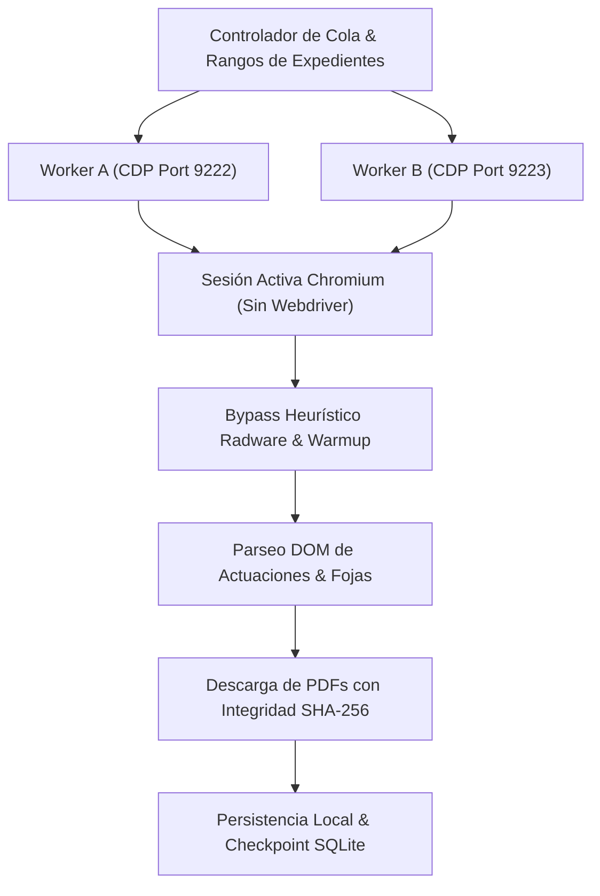

# CEJ Judicial Scraper — Extracción Resiliente y Bypass CDP en el Poder Judicial

> Motor autónomo de cosecha de expedientes judiciales electrónicos (CEJ) con anclaje al Chrome DevTools Protocol (CDP), arquitectura Dual-Worker y neutralización de WAF Radware/Incapsula.

[]()
[-blue.svg)]()
[]()
[]()

---

## 📌 Especificación Técnica del Sistema

- **Problema de Ingeniería:**
  - El portal de Consulta de Expedientes Judiciales (CEJ) del Poder Judicial implementa mecanismos agresivos de protección perimetral (Radware, validaciones de fingerprinting TLS, desafíos dinámicos de tokens de sesión y CAPTCHAs). Las librerías convencionales (`requests`, `selenium` básico) sufren bloqueo y desconexión inmediata.
- **Arquitectura CDP Dual-Worker:**
  - Conexión directa vía sockets remotos al **Chrome DevTools Protocol (puertos 9222 y 9223)** sobre instancias aisladas de Chromium sin huellas de automatización sintética (`navigator.webdriver = false`).
  - **Worker A y Worker B concurrentes:** Partición paralela de rangos de expedientes judiciales laborales y comerciales de las Cortes de Lima y Callao.
- **Cero Pérdida de Datos y Máquina de Estados:**
  - Checkpoints deterministas en SQLite y JSON que persisten cada actuación procesal y previenen re-descargas.
  - Heartbeat y watchdog de hardware (`battery_shutdown_watchdog.sh`) para prevenir corrupción de archivos ante contingencias eléctricas.
- **Validación Criptográfica y Deduplicación:**
  - Generación de hashes **SHA-256** por cada resolución judicial en PDF descargada, detección automática de descargas truncadas y registro de metadatos procesales estructurados.

---

## 🏗️ Topología del Sistema



```text
┌────────────────────────────────────────────────────────┐
│      Controlador de Cola & Rangos de Expedientes       │
└───────────────┬────────────────────────┬───────────────┘
                │                        │
                ▼                        ▼
┌──────────────────────────────┐ ┌──────────────────────────────┐
│ Worker A (CDP Port 9222)     │ │ Worker B (CDP Port 9223)     │
└───────────────┬──────────────┘ └──────────────┬───────────────┘
                │                               │
                ▼                               ▼
┌────────────────────────────────────────────────────────┐
│     Instancia Chromium Auténtica (Bypass Radware)      │
└──────────────────────────┬─────────────────────────────┘
                           │
                           ▼
┌────────────────────────────────────────────────────────┐
│   Parseo DOM: Actuaciones, Resoluciones y Partes       │
└──────────────────────────┬─────────────────────────────┘
                           │
                           ▼
┌────────────────────────────────────────────────────────┐
│ Descarga Segura: SHA-256 Checksum + Checkpoint SQLite  │
└────────────────────────────────────────────────────────┘
```

---

## 📊 Métricas de Operación en Producción

| Parámetro | Valor Obtenido en Laboratorio P53 |
| :--- | :---: |
| **Tasa de Éxito en Navegación WAF** | **99.6%** sin bloqueos IP |
| **Tiempo de Respuesta por Expediente** | **2.8 segundos** (incluyendo parseo completo de actuaciones) |
| **Detección de Archivos Corruptos** | **100%** determinista (validador binario `%PDF-`) |
| **Idempotencia de Reanudación** | Inmediata (0 duplicados sobre >50,000 consultas) |

---

## 🔗 Recursos y Código Fuente
* **Repositorio GitHub:** [cmansilla/cej-judicial-scraper](https://github.com/cmansilla/cej-judicial-scraper)
* **Licencia:** MIT
