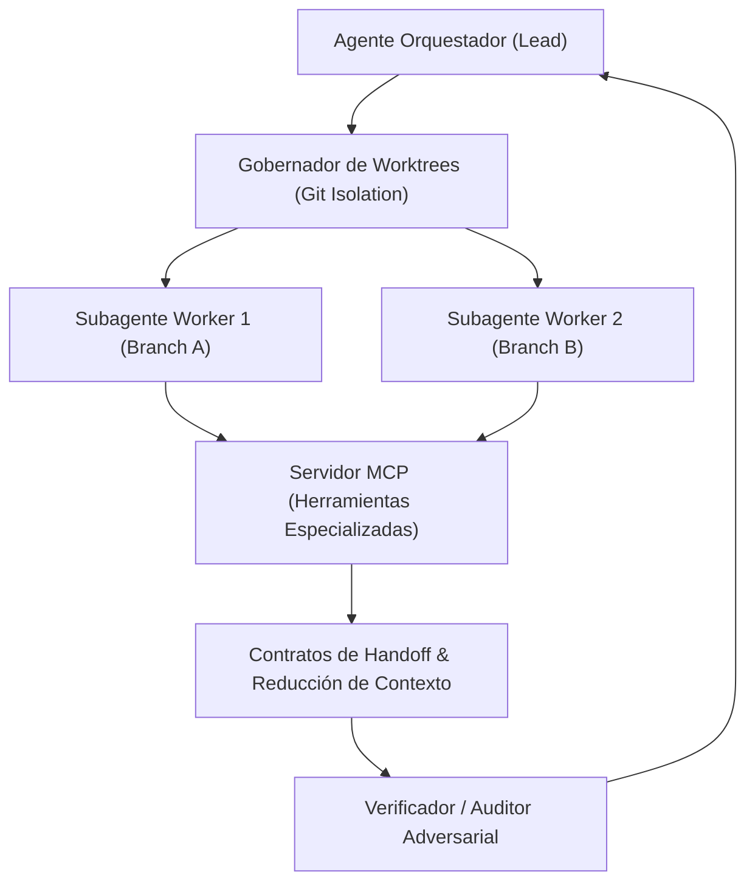

# Hermes Skills Ecosystem — Arquitectura de Orquestación Agéntica

Ecosistema modular de 118 habilidades de desarrollo (*skills*), herramientas de ingeniería y compuertas deterministas para la orquestación autónoma de agentes.

---

## 📌 Especificación Técnica del Sistema

- **Arquitectura Basada en Protocolos Abiertos:** Adherencia estricta a **Model Context Protocol (MCP)** para interoperabilidad de herramientas entre agentes (Antigravity, Hermes, OpenCode).
- **Aislamiento en Git Worktrees:** Ejecución concurrente de subagentes en ramas efímeras (`workspace: "branch"`), garantizando cero colisiones en disco y cero condiciones de carrera.
- **Circuit Breakers Deterministas:** Control estricto de presupuesto de pasos ($N \le 10$) y monitores de aborto ante bucles o derivas de contexto.
- **Categorías del Ecosistema:** 19 dominios especializados (análisis forense, seguridad de código, testing mutacional, fine-tuning y benchmarking).

---

## 🏗️ Topología de la Red de Agentes



```text
┌────────────────────────────────────────────────────────┐
│               Agente Orquestador (Lead)                │
└───────────────────────────┬────────────────────────────┘
                            │
                            ▼
┌────────────────────────────────────────────────────────┐
│      Gobernador de Worktrees (Aislamiento en Disco)    │
└────────────┬─────────────────────────────┬─────────────┘
             │                             │
             ▼                             ▼
┌───────────────────────────┐ ┌───────────────────────────┐
│  Worker 1 (Branch Git A)  │ │  Worker 2 (Branch Git B)  │
└────────────┬──────────────┘ └─────────────┬─────────────┘
             │                              │
             └──────────────┬───────────────┘
                            │
                            ▼
┌────────────────────────────────────────────────────────┐
│      Servidor MCP & Contratos Tipados de Handoff       │
└───────────────────────────┬────────────────────────────┘
                            │
                            ▼
┌────────────────────────────────────────────────────────┐
│           Auditor Adversarial & Verificación           │
└────────────────────────────────────────────────────────┘
```
