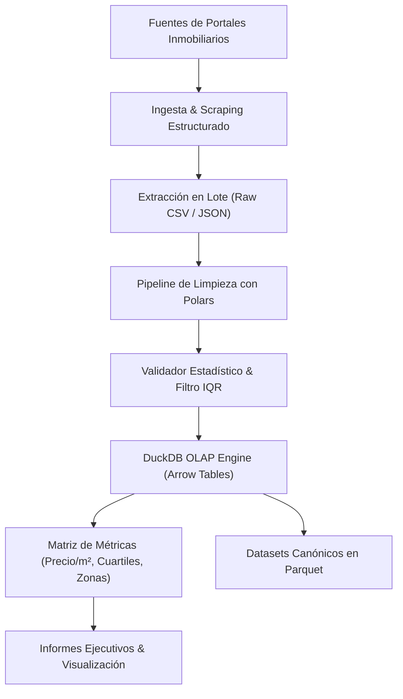

# InmobiliariaData — Arquitectura de Ingeniería de Datos Geoespaciales

Pipeline de ingesta, saneamiento, validación estadística y análisis econométrico sobre **25,292 avisos inmobiliarios** estructurados en Lima Metropolitana.

---

## 📌 Especificación Técnica del Sistema

- **Motor de Cómputo OLAP:** **DuckDB** nativo con integración columnar **Apache Arrow** y **Polars**.
  - Operaciones vectorizadas en memoria con cero-copia (*Zero-Copy I/O*).
  - Tiempos de agregación y cálculo de percentiles en menos de 150 ms sobre el dataset completo.
- **Calidad de Datos & Sanitización:**
  - Detección y poda de valores atípicos (*outliers*) mediante rangos intercuartílicos (IQR) multivariables.
  - Normalización de tipos de cambio (USD / PEN) con tipos de cambio históricos referenciales.
  - Imputación determinista de coordenadas geoespaciales y delimitación de distritos.
- **Entregables de Datos:**
  - 10 Datasets normalizados en formatos Parquet y CSV indexado.
  - Tableros ejecutivos de ratios precio/m², rentabilidad estimada y correlaciones de zonificación.

---

## 🏗️ Topología del Pipeline de Datos



```text
┌────────────────────────────────────────────────────────┐
│             Fuentes de Datos Inmobiliarios             │
└───────────────────────────┬────────────────────────────┘
                            │
                            ▼
┌────────────────────────────────────────────────────────┐
│           Ingesta & Parsing de Datos Crudos            │
└───────────────────────────┬────────────────────────────┘
                            │
                            ▼
┌────────────────────────────────────────────────────────┐
│          Pipeline de Sanitización con Polars           │
│     (Conversión de Moneda, Limpieza de Outliers)       │
└───────────────────────────┬────────────────────────────┘
                            │
                            ▼
┌────────────────────────────────────────────────────────┐
│        DuckDB OLAP Engine (Procesamiento Vectorial)    │
└───────────────────────────┬────────────────────────────┘
                            │
             ┌──────────────┴──────────────┐
             ▼                             ▼
┌───────────────────────────┐ ┌───────────────────────────┐
│ Datasets Canónicos Parquet│ │  Matriz Geoespacial m²    │
└───────────────────────────┘ └───────────────────────────┘
```
