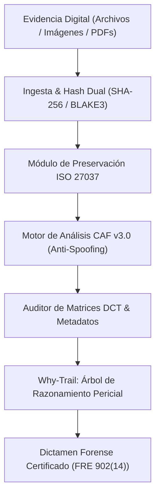

# LexProof Forensic Engine — Arquitectura Pericial Digital

Motor de análisis forense digital y preservación de evidencia conforme a estándares internacionales **ISO/IEC 27037** (cadena de custodia) e **ISO/IEC 27042** (análisis e interpretación pericial).

---

## 📌 Especificación Técnica del Sistema

- **Cadena de Custodia Inmutable:**
  - Hashing criptográfico dual (SHA-256 + BLAKE3) generado en el momento exacto de la ingesta.
  - Generación de sellos de tiempo deterministas y logs forenses auditables para admisibilidad legal bajo regla **FRE 902(14)**.
- **Detección Anti-Anti-Forensics (CAF v3.0):**
  - Detección de *EXIF Spoofing*, manipulación de metadatos y re-compresiones mediante software de edición.
  - Análisis de artefactos de cuantización JPEG y matrices DCT para identificar inserciones de contenido generado por IA.
- **Reportes Periciales:** Exportación automatizada de dictámenes periciales estructurados con árbol de dependencias probatorias (*Why-Trail*).

---

## 🏗️ Topología del Sistema



```text
┌────────────────────────────────────────────────────────┐
│             Evidencia Digital (Archivos/PDF)           │
└───────────────────────────┬────────────────────────────┘
                            │
                            ▼
┌────────────────────────────────────────────────────────┐
│        Ingesta & Hash Dual (SHA-256 / BLAKE3)          │
└───────────────────────────┬────────────────────────────┘
                            │
                            ▼
┌────────────────────────────────────────────────────────┐
│     Análisis CAF v3.0 (Detección Manipulación IA)      │
└───────────────────────────┬────────────────────────────┘
                            │
                            ▼
┌────────────────────────────────────────────────────────┐
│     Dictamen Pericial Certificado (ISO 27042 / FRE)    │
└────────────────────────────────────────────────────────┘
```
