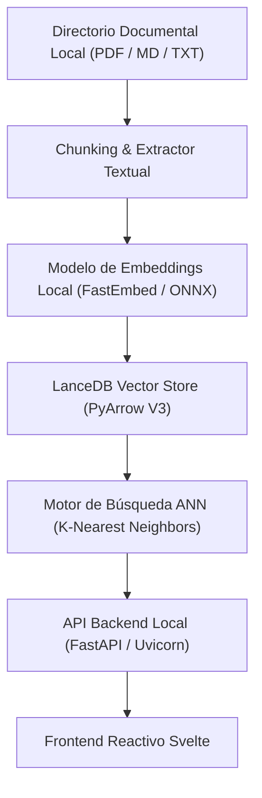

# LocalSearchEngine V2 — Arquitectura de Búsqueda Semántica Offline

Buscador semántico y vectorial 100% offline para documentación técnica local, utilizando bases de datos vectoriales embebidas y frontend reactivo en Svelte.

---

## 📌 Especificación Técnica del Sistema

- **Motor Vectorial:** **LanceDB** embebido sobre almacenamiento en formato columnar **Apache Arrow** (`SCHEMA_V3`).
  - Indexación de **14,256 fragmentos** documentales con embeddings densos precalculados.
  - Búsqueda aproximada de vecinos más cercanos (*ANN*) de latencia sub-5ms sin servidor externo de base de datos.
- **Frontend & Visualización:** SPA ligera en **Svelte** compilada sin sobrecarga de runtime.
- **Modo Offline-First:** Cero telemetría y cero dependencias de APIs en la nube durante el ciclo de búsqueda y lectura.

---

## 🏗️ Topología del Sistema



```text
┌────────────────────────────────────────────────────────┐
│           Documentos Locales (PDF / MD / TXT)          │
└───────────────────────────┬────────────────────────────┘
                            │
                            ▼
┌────────────────────────────────────────────────────────┐
│               Chunking & Extractor Textual             │
└───────────────────────────┬────────────────────────────┘
                            │
                            ▼
┌────────────────────────────────────────────────────────┐
│         Modelo de Embeddings Local (ONNX / CPU)        │
└───────────────────────────┬────────────────────────────┘
                            │
                            ▼
┌────────────────────────────────────────────────────────┐
│        LanceDB Vector Store (14,256 Chunks Arrow)      │
└───────────────────────────┬────────────────────────────┘
                            │
                            ▼
┌────────────────────────────────────────────────────────┐
│          Búsqueda Semántica ANN + Interfaz Svelte      │
└────────────────────────────────────────────────────────┘
```
