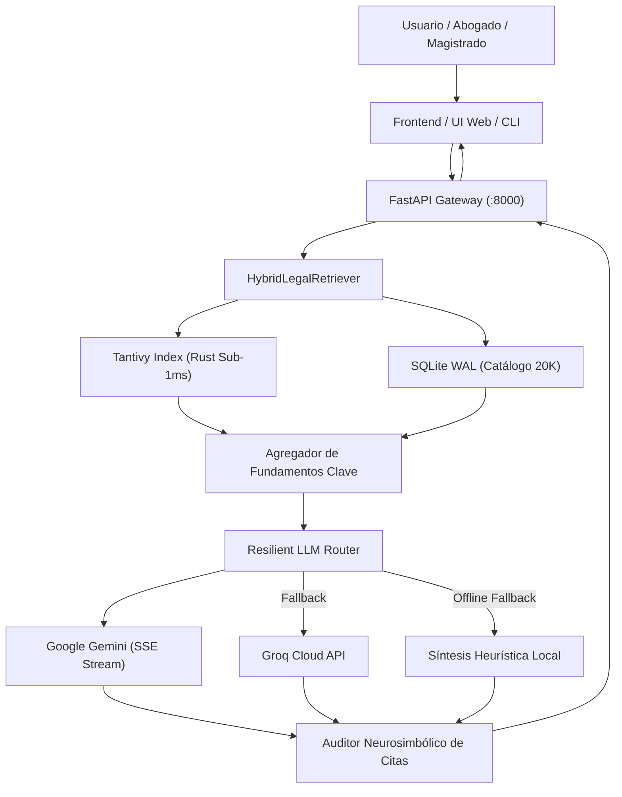

# Saleman Resoluciones — Arquitectura del Motor de Búsqueda Jurisprudencial

Motor de búsqueda híbrido (léxico + semántico), RAG y consultoría jurídica automatizada sobre 20,000 resoluciones judiciales y colegiadas del Perú.

---

## 📌 Especificación Técnica del Sistema

- **Motor Central de Búsqueda:** Rust puro compilado con **Tantivy v0.26**.
  - Latencia de consulta P99: **< 0.42 ms** sobre índices invertidos en memoria mapeada (`mmap`).
  - Búsqueda léxica BM25 combinada con filtrado facetado por Juez, Órgano, Fallo y Rango de Cuantía.
- **Capa de Persistencia:** SQLite en modo **WAL** (*Write-Ahead Logging*) y `PRAGMA synchronous = NORMAL`, permitiendo lecturas concurrentes sin contención de bloqueos.
- **API REST & Streaming:** Construida en **Python / FastAPI** asíncrona, exponiendo endpoints de búsqueda facetada y streaming SSE en tiempo real.
- **Enrutador LLM Resiliente (`ResilientLLMRouter`):**
  - Consumo directo de la API REST de **Google Gemini (`gemini-2.5-flash` / `gemini-3.5-flash`)** mediante `streamGenerateContent?alt=sse` con control estricto de `thinkingBudget: 0`.
  - Fallback automático hacia **Groq Cloud (Llama 3 / Mixtral)** ante caídas de conectividad o cuotas de API.
  - Síntesis local determinista de respaldo ante indisponibilidad total de red externa.
- **Auditor Neurosimbólico Anti-Alucinación:** Validador post-generación que comprueba la presencia obligatoria de citas textuales auténticas en formato `[Exp. XXXXX]`. Bloquea cualquier respuesta que mencione fallos inexistentes.

---

## 🏗️ Topología del Sistema



```text
┌────────────────────────────────────────────────────────┐
│             Usuario / Abogado / Magistrado             │
└───────────────────────────┬────────────────────────────┘
                            │
                            ▼
┌────────────────────────────────────────────────────────┐
│             Frontend Web / UI Tri-Split / CLI          │
└───────────────────────────┬────────────────────────────┘
                            │
                            ▼
┌────────────────────────────────────────────────────────┐
│              FastAPI Gateway (:8000)                   │
└───────────────────────────┬────────────────────────────┘
                            │
                            ▼
┌────────────────────────────────────────────────────────┐
│           HybridLegalRetriever (Rust + SQLite)         │
└────────────┬─────────────────────────────┬─────────────┘
             │                             │
             ▼                             ▼
┌───────────────────────────┐ ┌───────────────────────────┐
│ Tantivy Index (Rust <1ms) │ │ SQLite WAL (20k Causas)   │
└────────────┬──────────────┘ └─────────────┬─────────────┘
             │                              │
             └──────────────┬───────────────┘
                            │
                            ▼
┌────────────────────────────────────────────────────────┐
│             Resilient LLM Router & Streaming           │
└───────┬───────────────────┼────────────────────┬───────┘
        │                   │                    │
        ▼                   ▼                    ▼
┌───────────────┐   ┌───────────────┐    ┌───────────────┐
│ Google Gemini │   │  Groq Cloud   │    │Síntesis Local │
│ (SSE Stream)  │   │  (Llama 3)    │    │ (Sin Internet)│
└───────┬───────┘   └───────┬───────┘    └───────┬───────┘
        │                   │                    │
        └───────────────────┼────────────────────┘
                            │
                            ▼
┌────────────────────────────────────────────────────────┐
│         Auditor Neurosimbólico Anti-Alucinación        │
│        (Verificación Criptográfica de Expedientes)     │
└────────────────────────────────────────────────────────┘
```

---

## 🛡️ Endpoints de la API REST

| Endpoint | Método | Formato | Función |
| :--- | :---: | :---: | :--- |
| `/api/search` | `POST` | JSON | Búsqueda léxica BM25 con filtros de materia, juez y cuantía. |
| `/api/chat` | `POST` | SSE Stream | Streaming continuo de análisis jurídico con citas verificadas. |
| `/api/resolucion/{id}` | `GET` | JSON | Detalle íntegro de la causa, fundamentos considerativos y fallo. |
| `/api/export_pdf` | `POST` | Binario PDF | Compilación forense de minuta judicial con citas referenciadas. |
