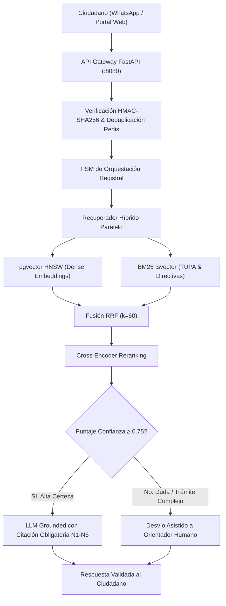

# SUNARP Chat AI & RAG Grounder — Orientación Registral con Anclaje Estricto

Arquitectura de recuperación aumentada por recuperación híbrida (Dense + Sparse) y canal conversacional para la Superintendencia Nacional de los Registros Públicos (SUNARP). Cumple con los requerimientos de la Ley N° 31814 (Ley de IA en el Perú) y la Ley N° 27444 (LPAG).

---

## 📌 Especificación Técnica del Sistema

- **Motor de Recuperación Híbrida:**
  - **Dense Vector Search:** Embeddings multilingües sobre `pgvector` con indexación **HNSW** (`m = 16`, `ef_construction = 64`, distancia coseno).
  - **Sparse Lexical Search:** BM25 nativo mediante `tsvector` en PostgreSQL con ponderación jerárquica de encabezados y sumillas registrales.
  - **Reciprocal Rank Fusion (RRF):** Fusión determinista con constante $k=60$ para combinar listas ordenadas sin distorsión de escalas.
- **Cross-Encoder Reranker:** Reordenamiento semántico profundo de los Top-15 candidatos reducidos a un Top-3 de alta confianza contextual.
- **Jerarquía Normativa y Grounding Estricto:** Ponderación determinista de 6 niveles (N1: Leyes Marco $\to$ N2: TUO RGRP $\to$ N3: Reglamentos Especiales $\to$ N4: TUPA Institucional $\to$ N5: Precedentes del Tribunal Registral $\to$ N6: Resoluciones Vinculantes).
- **FSM Tripartita & Handoff Humano:**
  - Nivel 1: Orientación informativa automatizada con cita legal obligatoria.
  - Nivel 2: Consultas transaccionales de sólo lectura (Síguelo Plus, placas vehiculares).
  - Nivel 3: Desacoplamiento a consola de orientador humano cuando la confianza RAG sea inferior a 0.75.
- **Integración Omnicanal Segura:** Webhook asíncrono para WhatsApp Business Cloud API (Graph API v22+) con validación criptográfica `X-Hub-Signature-256` HMAC-SHA256 y deduplicación por `message_id` en Redis.

---

## 🏗️ Topología del Sistema



```text
┌────────────────────────────────────────────────────────┐
│          Ciudadano (WhatsApp / Portal Web)             │
└───────────────────────────┬────────────────────────────┘
                            │
                            ▼
┌────────────────────────────────────────────────────────┐
│     Verificación HMAC-SHA256 & Deduplicación Redis     │
└───────────────────────────┬────────────────────────────┘
                            │
                            ▼
┌────────────────────────────────────────────────────────┐
│             FSM de Orquestación Registral              │
└───────────────────────────┬────────────────────────────┘
                            │
                            ▼
┌────────────────────────────────────────────────────────┐
│             Recuperación Híbrida Paralela              │
│       ┌──────────────────────┬───────────────────┐     │
│       │ pgvector HNSW (Dense)│ BM25 tsvector     │     │
│       └──────────┬───────────┴─────────┬─────────┘     │
└──────────────────┼─────────────────────┼───────────────┘
                   │                     │
                   └──────────┬──────────┘
                              │
                              ▼
┌────────────────────────────────────────────────────────┐
│      Fusión RRF (k=60) + Cross-Encoder Reranker        │
└───────────────────────────┬────────────────────────────┘
                            │
                            ▼
┌────────────────────────────────────────────────────────┐
│             ¿Puntaje de Confianza ≥ 0.75?              │
└─────────────┬────────────────────────────┬─────────────┘
              │ Sí (Alta Certeza)          │ No (Duda / Excepción)
              ▼                            ▼
┌───────────────────────────┐┌───────────────────────────┐
│ Generación Grounded con   ││ Desvío Inmediato a        │
│ Base Legal TUPA/Directiva ││ Orientador Humano SUNARP  │
└───────────────────────────┘└───────────────────────────┘
```

---

## 💻 Componentes Nucleares de Código (Core Code Slices)

### 1. Fusión Reciprocal Rank Fusion (RRF) y Enrutamiento Híbrido

```python
from dataclasses import dataclass

@dataclass(frozen=True)
class RetrievalCandidate:
    doc_id: str
    content: str
    norma_nivel: str  # N1 a N6
    base_legal: str

def reciprocal_rank_fusion(
    dense_results: list[str],
    sparse_results: list[str],
    k_constant: int = 60
) -> list[tuple[str, float]]:
    """
    Combina las clasificaciones densas (pgvector) y dispersas (BM25)
    garantizando invarianza de escala en las puntuaciones.
    """
    rrf_scores: dict[str, float] = {}

    for rank, doc_id in enumerate(dense_results, start=1):
        rrf_scores[doc_id] = rrf_scores.get(doc_id, 0.0) + (1.0 / (k_constant + rank))

    for rank, doc_id in enumerate(sparse_results, start=1):
        rrf_scores[doc_id] = rrf_scores.get(doc_id, 0.0) + (1.0 / (k_constant + rank))

    # Ordenar descendentemente por puntuación combinada
    return sorted(rrf_scores.items(), key=lambda x: x[1], reverse=True)
```

### 2. Validador Neurosimbólico de Grounding y Citas Obligatorias

```python
import re

REGISTRAL_CITATION_REGEX = re.compile(
    r"(Ley\s+N[°º]?\s*\d+|D\.S\.\s*N[°º]?\s*[\d\-]+|Res\.\s*N[°º]?\s*[\d\-]+-[A-Z\/]+|TUPA\s+SUNARP\s+Ítem\s+\d+|Directiva\s+N[°º]?\s*\d+)",
    re.IGNORECASE
)

def verify_grounding_integrity(llm_output: str, confidence_score: float) -> dict[str, Any]:
    """
    Aplica compuerta de integridad estricta según Ley 31814:
    Si la respuesta carece de base legal positiva o la confianza es < 0.75,
    se bloquea la salida y se escala a un operador humano.
    """
    if confidence_score < 0.75:
        return {
            "status": "ESCALAR_A_HUMANO",
            "reason": f"Puntaje de confianza ({confidence_score:.2f}) bajo el umbral mínimo (0.75)."
        }

    citas_detectadas = REGISTRAL_CITATION_REGEX.findall(llm_output)
    if not citas_detectadas:
        return {
            "status": "ESCALAR_A_HUMANO",
            "reason": "La respuesta no cita textualmente ninguna norma, directiva o ítem del TUPA."
        }

    return {
        "status": "APROBADO",
        "citas_validadas": list(set(citas_detectadas))
    }
```

---

## 📊 Especificación de Fuentes de Datos (Corpus Registral)

| Nivel | Instrumento Jurídico | Volumen de Chunks | Estrategia de Indexación |
| :---: | :--- | :---: | :--- |
| **N1** | Ley N° 26366 y Código Civil (Libro IX) | 480 | pgvector (Dense) + tsvector |
| **N2** | TUO del Reglamento General de Registros Públicos | 1,240 | Parent-Child (Artículos íntegros) |
| **N3** | Reglamentos de Inscripciones (Predios, Sociedades, Vehicular) | 3,890 | BM25 con boost de ponderación léxica |
| **N4** | TUPA SUNARP (Requisitos, Tasas y Plazos) | 860 | Extracción tabular normalizada JSON |
| **N5** | Precedentes de Observancia Obligatoria (Tribunal Registral) | 520 | Inserción obligatoria en prompt de contexto |

---

## 🚧 Brechas Técnicas y Qué Falta (Roadmap Pendiente)

- [ ] **Configuración del Webhook Meta en Producción:** Asociar el número de línea oficial con el BSP de WhatsApp y almacenar el token de larga duración en Google Cloud Secret Manager.
- [ ] **Clúster Redis de Alta Disponibilidad:** Migrar el servidor Redis standalone a una topología Sentinel con replicación para mitigar riesgos de duplicación de mensajes en picos de tráfico.
- [ ] **Conexión en Vivo con Síguelo Plus API:** Habilitar el conector REST oficial con autenticación mTLS hacia los servicios internos de SUNARP para consulta transaccional de estados de títulos en tiempo real.
