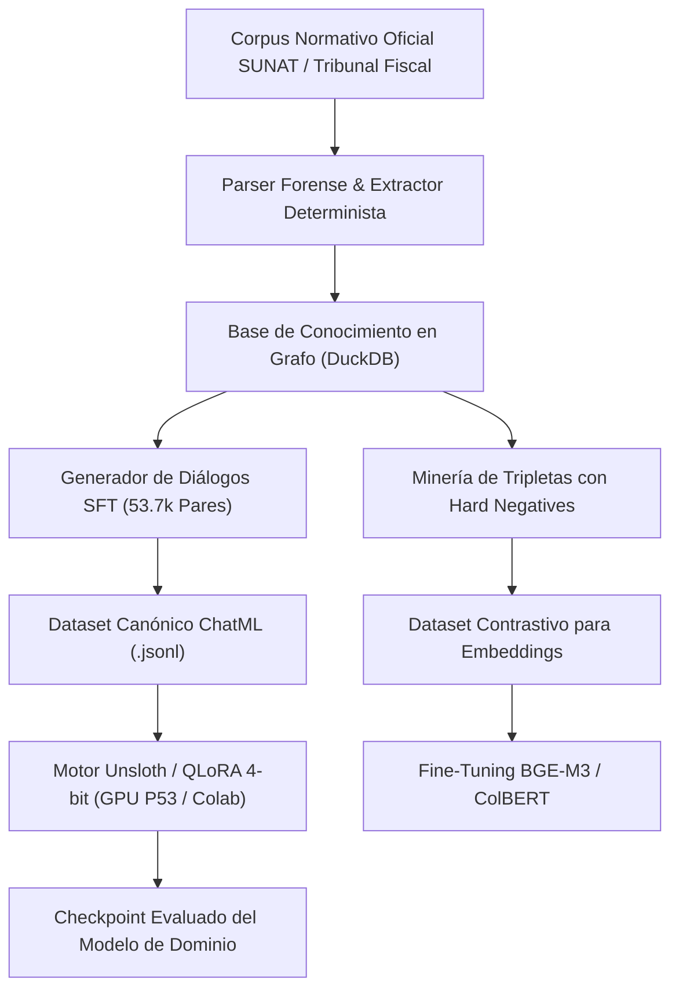

# SUNAT Expert AI — Arquitectura de Post-Entrenamiento SFT

Pipeline de post-entrenamiento supervisado (*Supervised Fine-Tuning - SFT*), minería de tripletas contrastivas y base de conocimiento en grafo para modelos de lenguaje especializados en normativa tributaria y aduanera peruana.

---

## 📌 Especificación Técnica del Sistema

- **Dataset SFT Especializado:**
  - **53,770 diálogos canónicos** estructurados en formato **ChatML**, cubriendo Código Tributario, Ley del Impuesto a la Renta, IGV y resoluciones del Tribunal Fiscal.
  - Generación sintética controlada con validación determinista de artículos y citas legales.
- **Minería de Tripletas Contrastivas:**
  - Pares `(Anchor, Positive, Negative)` con minería de *Hard Negatives* para el ajuste de modelos de embeddings de alta dimensionalidad (BGE-M3 y ColBERT v2).
- **Base de Conocimiento en Grafo:**
  - Base de datos relacional y de relaciones normativas en **DuckDB** sobre 2,566 documentos oficiales validados.
- **Infraestructura de Entrenamiento:**
  - Orquestación con **Unsloth** y **PEFT (QLoRA 4-bit)** sobre entornos GPU dedicados (Workstation ThinkPad P53 / Google Colab Blackwell G4).
  - Optimización de memoria VRAM reducida hasta en un 80% frente a backends estándar de PyTorch.

---

## 🏗️ Topología del Pipeline de Entrenamiento



```text
┌────────────────────────────────────────────────────────┐
│     Corpus Normativo Oficial (SUNAT / Resoluciones)    │
└───────────────────────────┬────────────────────────────┘
                            │
                            ▼
┌────────────────────────────────────────────────────────┐
│        Base de Conocimiento en Grafo (DuckDB)          │
└───────────────────────────┬────────────────────────────┘
                            │
             ┌──────────────┴──────────────┐
             ▼                             ▼
┌───────────────────────────┐ ┌───────────────────────────┐
│ Generador SFT (53.7k Chat)│ │ Minería Hard Negatives    │
└────────────┬──────────────┘ └─────────────┬─────────────┘
             │                              │
             ▼                              ▼
┌───────────────────────────┐ ┌───────────────────────────┐
│ Dataset ChatML JSONL      │ │ Dataset Contrastivo       │
└────────────┬──────────────┘ └─────────────┬─────────────┘
             │                              │
             ▼                              ▼
┌───────────────────────────┐ ┌───────────────────────────┐
│ Entrenamiento LLM Unsloth │ │ Fine-Tuning Embeddings    │
└───────────────────────────┘ └───────────────────────────┘
```
