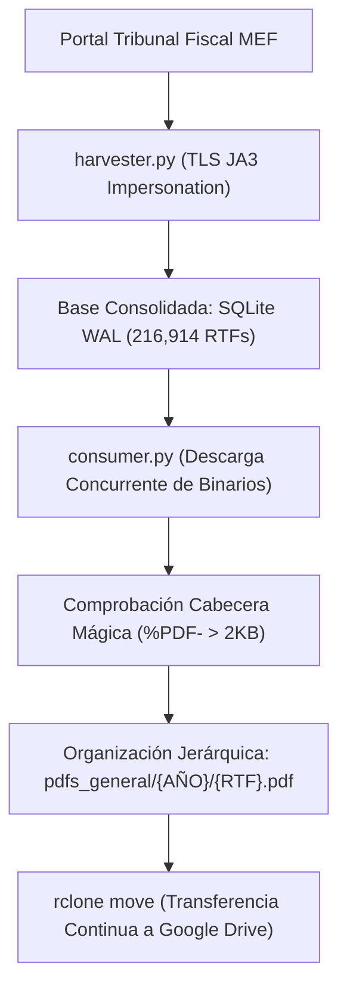

# Tribunal Fiscal Harvester — Pipeline Asíncrono para 216k+ RTFs

> Motor de recolección masiva, verificación criptográfica de integridad y offload a la nube para 216,914 resoluciones del Tribunal Fiscal (MEF Perú, 2012–2026).

[](https://github.com/cmansilla/tribunal-fiscal-harvester)
[]()
[]()
[]()

---

## 📌 Especificación Técnica del Sistema

- **Magnitud del Acervo Cosechado:**
  - **216,914 resoluciones indexadas** en SQLite con metadatos completos (número de RTF, sala, año, fecha de emisión, sumilla oficial y enlace binario).
  - **215,479 PDFs íntegros validados** (tasa de éxito del **99.34%**; 0.65% restante corresponde a documentos inexistentes en el servidor de origen MEF).
  - Cobertura de 15 ejercicios fiscales completos (**2012 a 2026**).
- **Pipeline en Dos Etapas Desacopladas:**
  - **Etapa 1 — Harvester (`harvester.py`):** Cosecha de metadatos mediante `curl_cffi` con suplantación de handshake TLS JA3 (perfil Chrome). Sesiones estabilizadas con cookies de navegación y auto-resunción desde la última frontera registrada en SQLite.
  - **Etapa 2 — Binary Consumer (`consumer.py`):** Descarga multihilo que analiza la cabecera mágica `%PDF-` y descarta payloads falsos (soft-404 de 212 bytes emitidos por el portal gubernamental).
- **Arquitectura de Almacenamiento Acotado (Continuous Cloud Offload):**
  - Mantenimiento determinista de cuotas de disco NVMe local mediante script sincronizador con `rclone`, transfiriendo carpetas anuales cerradas a Google Drive para evitar saturación de inodos.

---

## 🏗️ Topología del Sistema



```text
┌────────────────────────────────────────────────────────┐
│              Portal Tribunal Fiscal - MEF              │
└──────────────────────────┬─────────────────────────────┘
                           │
                           ▼
┌────────────────────────────────────────────────────────┐
│     harvester.py (curl_cffi TLS JA3 Impersonator)      │
│     Cosecha asíncrona con auto-resume desde SQLite     │
└──────────────────────────┬─────────────────────────────┘
                           │
                           ▼
┌────────────────────────────────────────────────────────┐
│     SQLite WAL (216,914 registros con sumilla y URL)   │
└──────────────────────────┬─────────────────────────────┘
                           │
                           ▼
┌────────────────────────────────────────────────────────┐
│     consumer.py (Descarga Concurrente de Binarios)     │
│     Validador determinista: %PDF- y tamaño > 2KB       │
└──────────────────────────┬─────────────────────────────┘
                           │
                           ▼
┌────────────────────────────────────────────────────────┐
│  rclone move -> Offload automático a Google Drive      │
└────────────────────────────────────────────────────────┘
```

---

## 📊 Balance Volumétrico Consolidado (2012–2026)

| Periodo | Resoluciones en BD | Descargados OK | Tasa de Éxito | Estado Operativo |
| :---: | :---: | :---: | :---: | :---: |
| **2026** | 3,841 | 3,840 | 99.97% | Completado |
| **2025** | 15,605 | 15,590 | 99.91% | Completado |
| **2024** | 15,507 | 15,379 | 99.17% | Completado |
| **2023** | 13,601 | 13,580 | 99.85% | Completado |
| **2022** | 12,212 | 12,200 | 99.90% | Completado |
| **2021** | 14,231 | 13,949 | 98.02% | Completado |
| **2020** | 9,874 | 9,745 | 98.69% | Completado |
| **2019** | 15,499 | 15,468 | 99.80% | Completado |
| **2018** | 14,550 | 14,432 | 99.19% | Completado |
| **2017** | 15,505 | 15,328 | 98.86% | Completado |
| **2016** | 14,998 | 14,786 | 98.59% | Completado |
| **2015** | 15,637 | 15,373 | 98.31% | Completado |
| **2014** | 16,877 | 16,873 | 99.98% | Completado |
| **2013** | 19,235 | 19,235 | 100.00% | Completado |
| **2012** | 19,742 | 19,701 | 99.79% | Completado |
| **TOTAL** | **216,914** | **215,479** | **99.34%** | **Cerrado y Validado** |

---

## 🔗 Recursos y Código Fuente
* **Repositorio GitHub:** [cmansilla/tribunal-fiscal-harvester](https://github.com/cmansilla/tribunal-fiscal-harvester)
* **Licencia:** MIT
